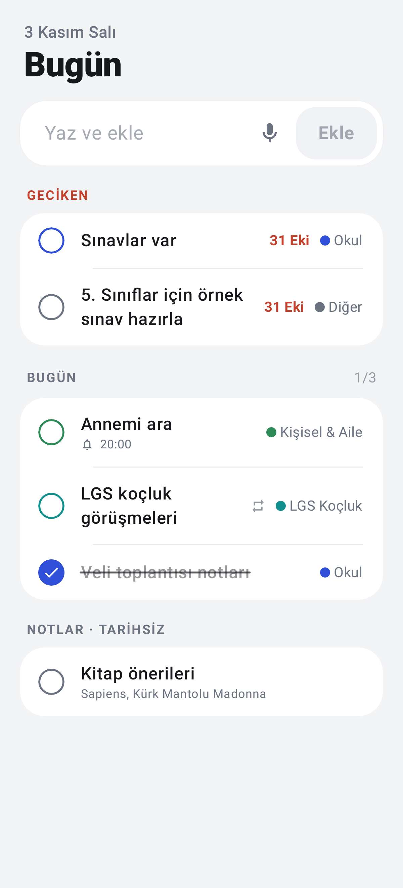
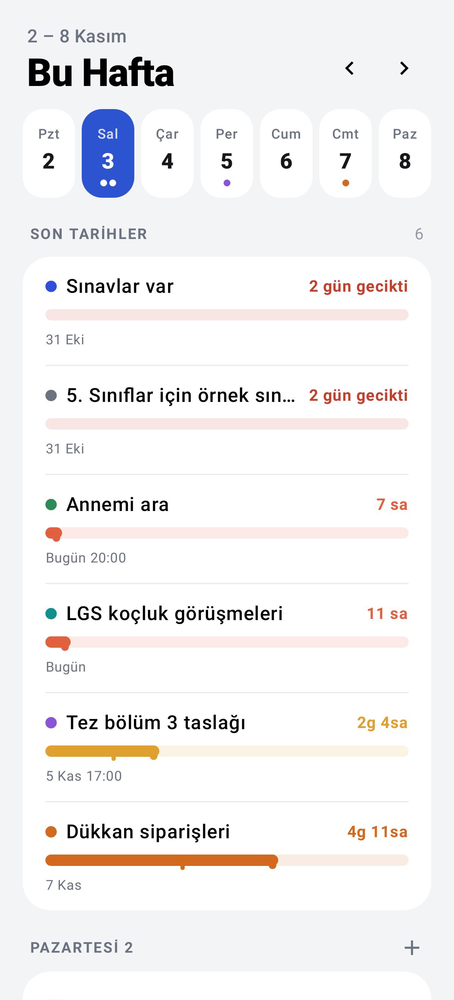
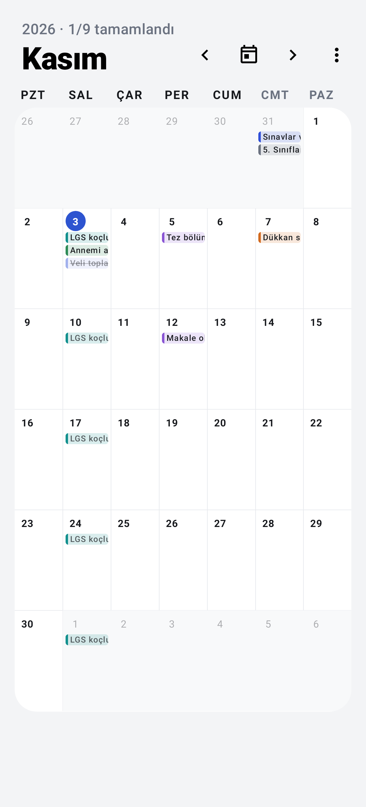
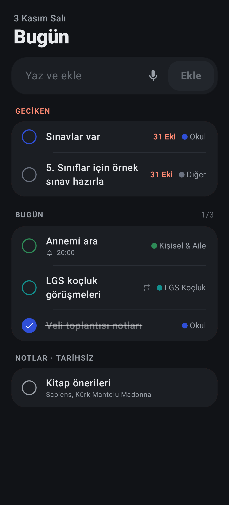

# Ajanda — Görev, Deadline ve Aylık Matris Ajanda (Android)

Kotlin + Jetpack Compose (Material 3) + Room + Jetpack Glance ile yazılmış, offline-first görev/not uygulaması.

**Hazır APK:** [`../apk/Ajanda-v1.1.0.apk`](../apk/Ajanda-v1.1.0.apk) (minSdk 26 / Android 8.0+, targetSdk 35)

| Bugün | Hafta (eriyen çubuklar) | Ay | Koyu tema |
|---|---|---|---|
|  |  |  |  |

## Özellikler
| Alan | Uygulama |
|---|---|
| Görev & not | Başlık, not, 4 seviye öncelik, alt görevler, kaydırarak silme + geri al |
| Deadline & hatırlatıcı | Tarih/saat, "zamanında / 10 dk / 30 dk / 1 saat / 1 gün önce"; `AlarmManager` (tam zamanlı) + bildirimde **Tamamlandı** butonu; yeniden başlatmada alarmlar geri kurulur |
| Tekrarlanan görevler | Günlük / haftalık (gün seçimli: Pzt…Paz) / aylık / yıllık, sıklık ve bitiş tarihi; süresi geçen rutinler otomatik bugüne taşınır |
| Eriyen çubuklar | Hafta ekranında "Son tarihler": kalan süre 7 günlük ölçekte erir, uçtan damlar; sakin → turuncu (<3 gün) → kırmızı (<24 sa) |
| Akıllı etiketler | Renkli etiketler (İş, Kişisel, Öncelikli varsayılan), etiketle filtreleme |
| Aylık matris ajanda | `LazyVerticalGrid` 7 sütun (PAZ–CMT veya PZT–PAZ), hücrede renkli görev etiketleri, kaydırarak ay değiştirme, hücreye dokun → gün detayı + hızlı ekleme, uzun bas → detaylı görev |
| Dışa aktarma | Aylık matris A4 yatay **PDF** veya **PNG** olarak paylaş/kaydet |
| Widget'lar (Glance) | **Haftalık Görevler** (checkbox ile tamamla), **Son Tarihler** (eriyen çubuklar) ve **Aylık Özet** (hücrelerde renkli not etiketleri); yeniden boyutlandırılabilir |
| Hızlı Ayarlar kutucuğu | Bildirim panelinden tek dokunuşla "Hızlı Görev" |
| Sesli / akıllı komut | Türkçe ayrıştırıcı: "yarın saat 15 toplantı #iş acil", "her pazartesi akşam 7 spor", "15 kasım fatura öde önemli" |
| Hissiyat | Tamamlamada haptic (CONFIRM), yaylı onay animasyonu, soldan sağa üstü çizilme animasyonu |
| Görünüm | Aydınlık/Karanlık/Sistem, Material You, düz / çizgili / kareli / noktalı kağıt dokusu |

## Paket yapısı
```
app/src/main/java/com/okan/ajanda/
├── AjandaApp.kt                 # Application + AppContainer (manuel DI)
├── MainActivity.kt              # Tek activity, intent aksiyonları (hızlı ekle, sesli, görev aç)
├── data/
│   ├── local/                   # Room: TaskEntity, SubtaskEntity, TagEntity, TaskTagCrossRef,
│   │                            #       TaskWithDetails, Converters, TaskDao, TagDao, AppDatabase
│   ├── prefs/SettingsRepository.kt   # DataStore: tema, kağıt dokusu, hafta başlangıcı, haptic
│   └── repository/TaskRepository.kt # Tek veri kaynağı; hatırlatıcı + widget senkronu
├── domain/
│   ├── RecurrenceCalculator.kt  # Tekrar tarihleri (ay sonu kayması yok)
│   ├── VoiceCommandParser.kt    # Türkçe doğal dil → görev
│   └── DateText.kt              # Türkçe tarih biçimleri
├── reminder/                    # ReminderScheduler, ReminderReceiver, BootReceiver, NotificationHelper
├── ui/
│   ├── AjandaRoot.kt            # NavHost + yüzen hap menü (Bugün · Hafta · Ay · Ayarlar)
│   ├── AppViewModelProvider.kt
│   ├── theme/                   # Mürekkep & kağıt renk paleti, tipografi
│   ├── components/              # TaskLine, MeltingBar, FloatingNavBar, InlineAddField, …
│   ├── today/                   # Bugün: Geciken / Bugün / Tarihsiz + "Yaz ve ekle"
│   ├── week/                    # Hafta: gün şeridi, eriyen son tarih çubukları, günlük listeler
│   ├── edit/                    # Alt sayfa olarak görev düzenleme + ViewModel
│   ├── calendar/                # MonthMatrixScreen, MonthMatrix, CalendarViewModel, MonthExporter
│   ├── quickadd/                # Hızlı/sesli ekleme sayfası
│   └── settings/
├── widget/                      # Glance: WeeklyTaskWidget, DeadlineWidget, MonthSummaryWidget, ToggleTaskAction
└── tile/QuickAddTileService.kt
```

## Derleme
```bash
./gradlew :app:testDebugUnitTest   # birim testleri + ekran görüntüleri (app/build/shots)
./gradlew :app:assembleRelease     # app/build/outputs/apk/release/app-release.apk
```
Release derlemesi R8 ile küçültülür ve varsa `keystore/ajanda.keystore` ile imzalanır (anahtar repoya eklenmez; yoksa debug anahtarı kullanılır).
Play Store'a göndermeden önce `app/build.gradle.kts` içine kendi `signingConfig`'inizi ekleyin.
